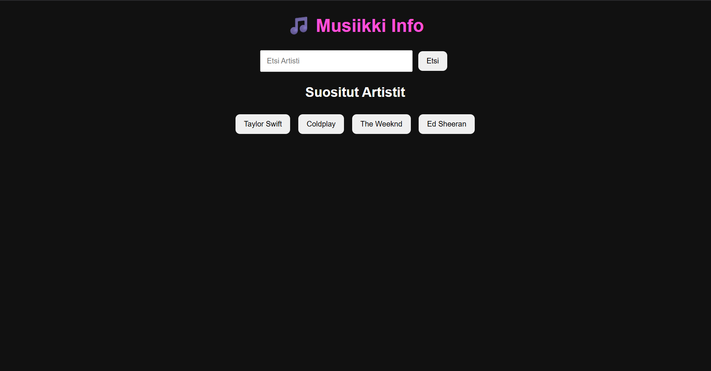
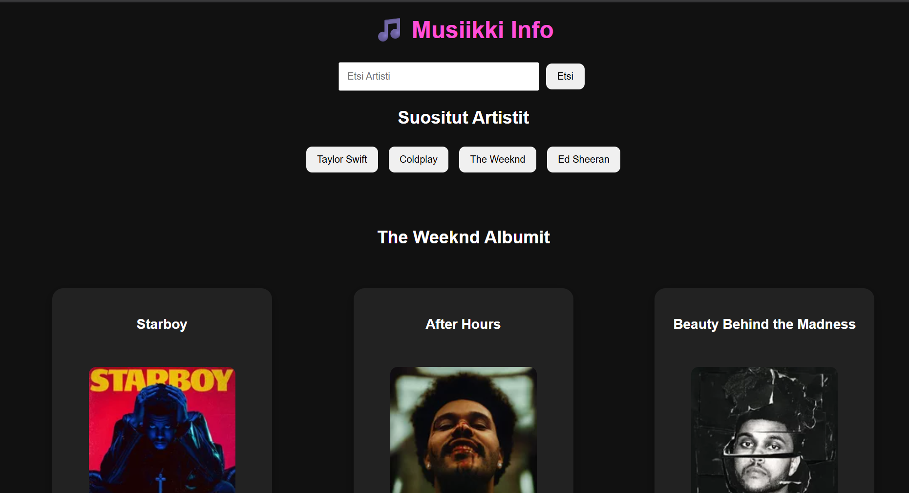

# Projektin nimi

**Tekijä(t):** Henrik Heiskanen / Jani Skogster

## Projektisuunnitelma

### Projektin idea

Musiikki Info on verkkosovellus, jonka avulla käyttäjä voi hakea tietoa eri artisteista ja heidän albumeistaan. Sovellus käyttää Last.fm API tiedon hakemiseen ja näyttää käyttäjälle artistien albumit, albumikuvat sekä albumien kappaleet.

Sovellus on tarkoitettu musiikista kiinnostuneille käyttäjille, jotka haluavat helposti löytää tietoa artisteista ja heidän musiikistaan.

### Suunnitellut toiminnot

Listaa vähintään kolme sovellukseesi suunniteltua toimintoa:

- Käyttäjä voi hakea artisteja hakukentän avulla.
- Sovellus näyttää artistin albumit, albumikuvat ja perustiedot.
- Käyttäjä voi avata albumin ja nähdä sen kappalelistan.

### Rautalankamalli / luonnos

Lisää tähän kuva käsin piirtämästäsi tai digitaalisesti tehdystä sovelluksen luonnoksesta. Luonnoksessa tulee näkyä sovelluksen pääasiallinen näkymä ja tärkeimmät elementit.

Esimerkki kuvan lisäämisestä:

## Verkkolinkit

- **Julkaistu sovellus:** [Lisää tähän GitHub Pages -osoite](https://yourusername.github.io/your-repository/)
- **GitHub-repositorio:** [Lisää tähän repositorion osoite](https://github.com/HenrikH0/Projekti_2a_Ajax_sovellus)

## Tietoja sovelluksesta

Musiikki Info on verkkosovellus, joka tarjoaa käyttäjälle tietoa artisteista ja heidän albumeistaan. Käyttäjä voi kirjoittaa artistin nimen hakukenttään, jonka jälkeen sovellus hakee tiedot Last.fm API avulla.

Sovellus näyttää artistin albumit korttimuodossa sisältäen albumin nimen, kuvan ja artistin tiedot. Käyttäjä voi myös avata albumin kappaleet ja nähdä sen sisältämät biisit.

Sovelluksen tavoitteena on tarjota helppo tapa tutkia musiikkia selkeän käyttöliittymän avulla.

## Teknologiat

- HTML – sivun rakenne ja sovelluksen elementit.
- CSS – käyttöliittymän ulkoasu, responsiivinen asettelu ja albumikorttien suunnittelu.
- JavaScript – sovelluksen toiminnallisuus, API-kutsut, JSON-datan käsittely ja DOM-elementtien luominen.
- Last.fm API – artistien, albumien ja kappaleiden tietojen hakeminen JSON-muodossa.

## Sovelluksen käyttö

1. Avaa julkaistu sovellus yllä olevasta linkistä.
2. Kirjoita hakukenttään haluamasi artistin nimi.
3. Paina Search-painiketta.
4. Tarkastele artistin albumeita ja albumikuvia.
5. Paina "Show songs" -painiketta nähdäksesi albumin kappaleet.

## Sovelluksen käynnistäminen paikallisesti

1. Kloonaa tai lataa projektin repositorio omalle koneellesi.
2. Avaa projektikansio Visual Studio Codessa.
3. Avaa index.html selaimessa tai käytä Live Server -laajennusta.
4. Sovellus hakee musiikkitiedot Last.fm API kautta.

## Kuvakaappaukset

Lisää tähän vähintään yksi kuvakaappaus toimivasta sovelluksestasi.

Esimerkki kuvan lisäämisestä:

## Tunnetut virheet / puutteet

Kerro, jos sovelluksessa on tunnettuja virheitä, puuttuvia toimintoja tai muita rajoituksia.

Jos tunnettuja virheitä ei ole, kirjoita: **Ei tunnettuja virheitä.**

## Työn jakautuminen

*Täytä tämä osio vain, jos teit projektin parityönä.*

Kuvaile, miten työ jakautui ja miten yhteistyö sujui.

- Tekijä 1: ...
- Tekijä 2: ...

## Oma arvio ja oppimisen reflektointi

Pohdi työtäsi ja oppimisprosessiasi.

- Missä onnistuin?
- Mikä oli haastavaa?
- Mitä parantaisin, jos aikaa olisi enemmän?
- Mitä opin HTML:stä, CSS:stä, JavaScriptistä ja DOM-skriptauksesta?
- Mikä jäi epäselväksi tai mistä haluaisin oppia lisää?
- Oma arvio projektista: **xx/10 pistettä**

## Lähteet ja kiitokset

Listaa kaikki projektissa käyttämäsi lähteet, tutoriaalit, kuvat ja koodiesimerkit.

Jos käytit ChatGPT:tä, GitHub Copilotia tai muuta tekoälytyökalua, mainitse se tässä ja kerro lyhyesti, miten se tuki työskentelyäsi.

- [Lähteen tai tutoriaalin nimi](https://example.com/)
- [Kuvalähde](https://example.com/)
- Käytetty tekoälytyökalu: ...
  - Miten työkalua käytettiin: ...

  ## Lisenssi

Tämä projekti on lisensoitu MIT-lisenssillä.

Lisätietoa lisenssin lisäämisestä GitHub-projektiin:
https://docs.github.com/en/communities/setting-up-your-project-for-healthy-contributions/adding-a-license-to-a-repository